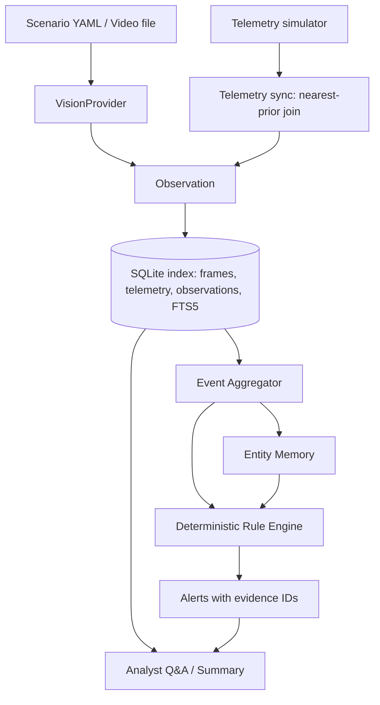

# Architecture (MVP)

Principle: **FRAME -> OBSERVATION -> EVENT -> MEMORY -> REASONING.** Frames are never judged in isolation.



## Stages
| Stage | Responsibility | Milestone |
|---|---|---|
| Scenario / Video | Text-frame scenarios (`ScriptedProvider`) or real video sampled with OpenCV (frame-diff gate skips near-identical frames) | M1, M5 |
| VisionProvider | Interface: frame in, validated observation drafts out. Providers: scripted, mock/cassette (replay cached responses, no key needed), real VLM later | M1, M5 |
| Telemetry sync | Telemetry samples (ts, position, altitude, battery, mode, zone) are joined to each frame by nearest-prior timestamp; the frame inherits `zone` and a wall-clock time from the simulated clock. Frames with no recent telemetry get a `stale_telemetry` flag | M1 |
| Observation | One detected object in one frame: class, attributes (colour, body type, description), zone, ts, frame_id, confidence, derived coarse `signature` | M1 |
| SQLite index | `frames`, `telemetry`, `observations` (the frame-by-frame index), later `events`, `entities`, `alerts`; FTS5 for keyword search; SQL filters by time/class/zone | M2 |
| Event Aggregator | Same class + zone + compatible attributes with a gap within tolerance extends one event (first_seen, last_seen, duration). Tolerance absorbs missed detections. No LLM involved | M3 |
| Entity Memory | At event close, same-signature entity with a sufficient revisit gap increments `visit_count` (e.g. blue pickup at 12:00 and 17:00) | M3 |
| Rule Engine | Deterministic rules with YAML thresholds, evaluated on every event update: loitering, after-hours presence, repeat vehicle, restricted-zone entry. Dedupe key and escalation | M4 |
| Alerts | Severity, message, evidence (event_ids, frame_ids) | M4 |
| Analyst Q&A / Summary | LangChain tool-calling over SQLite. Answers cite IDs; a verifier rejects unknown IDs; template fallback with no LLM. LangChain is confined to `drone_agent/agent` | M6 |

## Trust boundary
Rules decide; the LLM explains and answers from tool output only.

## Package layout
```
drone_agent/
  models/ telemetry/ vision/ store/ pipeline/ rules/ agent/   # agent/ is the only place langchain is imported
scenarios/  tests/  bench/  docs/
```
Dependency direction: `agent` -> `store`; `rules` -> `models`; core packages never import `agent`.
`tests/test_scaffold.py` enforces that the core does not import LangChain.

---

# Storage and search (M2)

Implemented in `drone_agent/store/` (schema in `schema.py`, API in `store.py`) and `drone_agent/ingest.py`.
Stdlib `sqlite3` only, with explicit parameterized SQL and no ORM.

## Why SQLite
Zero infrastructure (one file, ships with Python), transactional, and it supports both structured
filters (time, zone, object type) and full-text search (FTS5) in the same database, so a single
transaction covers a frame, its objects and its search entry. Persistence is at the application boundary:
rows are converted back into the validated M1 Pydantic models (`Observation`, `Telemetry`, ...).

## Schema (version 1, `PRAGMA user_version`)
| Table | Purpose | Key columns |
|---|---|---|
| `telemetry` | Simulated telemetry samples | `telemetry_id` PK, `timestamp`, `ts_utc` UNIQUE, lat/lon/alt/zone/battery (CHECK ranges) |
| `frames` | Frame-level index | `frame_id` PK, `timestamp`, `ts_utc`, `source`, `zone` |
| `observations` | One per frame | `observation_id` PK, `frame_id` UNIQUE FK, `timestamp`, `ts_utc`, `source`, `zone`, `description`, `telemetry_id` FK NULL, `telemetry_age_seconds`, `telemetry_stale` |
| `detected_objects` | Objects in an observation | `object_pk` PK, `observation_id` FK, `position`, `object_id` NULL, `object_type`, `activity` NULL, `confidence` (CHECK 0..1), `attributes_json` |
| `observations_fts` | FTS5 index | `observation_id` (UNINDEXED), `description`, `objects_text`, `zone` |

Foreign keys are enforced (`PRAGMA foreign_keys = ON`, verified on open). `frames` has no caption column
because the description lives once, on the observation. Events, entities and alerts are not stored yet (M3/M4).
The telemetry age/stale fields are on the observation because they describe *that association*, not the sample.

**Timestamps** are stored twice: `timestamp` is the exact ISO-8601 text including the UTC offset (so the
original timezone round-trips) and `ts_utc` is a fixed-width UTC string used for ordering, range filters and
indexes. Comparing ISO strings that carry different offsets would order them wrongly, so filters only use `ts_utc`.
Range filters (`start`, `end`) are inclusive on both ends.

**Attributes** (`{"color": "blue", "body_type": "pickup"}`) are canonical JSON text (sorted keys, no
whitespace, UTF-8 preserved) in `attributes_json`. Reason: keys are open-ended (whatever a VLM reports),
they are only read back as a whole, and searching them is FTS5's job. An attribute table would need extra
joins for no M2 benefit. They are re-validated by Pydantic when read. Consequence: attribute keys come back
in sorted order, and SQL cannot efficiently filter on an attribute value (SQLite JSON functions could later).

## FTS5 design
One FTS5 row per observation, written in the same transaction as the observation. Searchable text:
the description, an "objects text" (object type, activity and attribute values, e.g. `vehicle parked blue pickup`)
and the zone name. Tokenizer `porter unicode61`: case-insensitive, splits on punctuation
(`main_gate` becomes `main gate`) and stems English words (`walking` matches `walk`).

Search text is not passed to FTS5 as-is. Each word is extracted and double-quoted, and the words are ANDed,
so `blue pickup`, `person main gate` and hostile input such as `'; DROP TABLE x; --` or `NEAR(` are treated as
plain words and cannot inject FTS5 syntax. Results are ranked with BM25; structured filters can be combined with text.

**What FTS5 can do here:** keyword match across description, object attributes and zone; AND semantics; stemming; ranking.

**What it cannot do:** no synonyms or semantics (`truck` does not find an observation that only says `pickup`,
`car` does not find `sedan`), no prefix matching (`pick` does not match `pickup`), no typo tolerance, no phrase or
OR queries through this API, and no understanding of time or negation ("not after midnight" is just words).
Relevance ranking means text results are not chronological. Semantic search and embeddings are postponed by design.
If the SQLite build has no FTS5, opening the database fails with `Fts5UnavailableError`; there is no silent fallback.

## Indexes
| Index | Serves |
|---|---|
| `idx_observations_ts (ts_utc)` | time-range queries |
| `idx_observations_zone_ts (zone, ts_utc)` | zone filter, with or without a time range |
| `idx_objects_type_obs (object_type, observation_id)` | "observations containing object type X" (covering index for the existence probe) |
| implicit: `frames.frame_id`, `observations.observation_id`, `observations.frame_id`, `telemetry.ts_utc`, `detected_objects(observation_id, position)` | primary/unique keys |

`EXPLAIN QUERY PLAN` on the ingested `security_events` database (SQLite 3.45.1):
- zone + time range: `SEARCH o USING INDEX idx_observations_zone_ts (zone=? AND ts_utc>? AND ts_utc<?)`: index used.
- time only: `SEARCH o USING INDEX idx_observations_ts (ts_utc>? AND ts_utc<?)`: index used.
- object type: `SCAN o USING INDEX idx_observations_ts`, then `SEARCH d USING COVERING INDEX idx_objects_type_obs`
  per row. The index makes each probe cheap but the query still visits every observation, so it is linear in observation count.
- text search: `SCAN observations_fts VIRTUAL TABLE INDEX 0:M4`, then a primary-key lookup per matching row.
- Zone and time queries also show `USE TEMP B-TREE ... ORDER BY` because ties are broken by `frame_id`.

`query --explain` prints these plans. No performance or scale claims are made; measurements are M7.

## Ingestion, idempotency and transactions
`scenario -> simulated telemetry -> ScriptedProvider observations -> telemetry sync -> SQLite (+FTS)`.
Ingestion runs in ONE transaction: telemetry first (observations reference it by foreign key), then
frames/observations/objects/FTS rows.

**Idempotency decision: reject duplicates, atomically.** Ids are deterministic (`frame_id`, `obs-<frame_id>`,
telemetry timestamp), so re-ingesting the same scenario violates a PK/UNIQUE key, raises `DuplicateRecordError`,
and rolls everything back; the CLI exits 1 and the database is unchanged. Reason: an upsert could silently
overwrite stored evidence with a changed scenario that reuses the same ids. Trade-off: `frame_id` is a global
key in M2, so one database holds one run; a `run_id` for multi-run databases is a later design decision.

**Transactions:** `Store.transaction()` is a context manager: the outermost use is `BEGIN ... COMMIT/ROLLBACK`,
nested uses are `SAVEPOINT`s, so a failure inside a nested block undoes only that block. `insert_observation`
is atomic on its own (frame + observation + objects + FTS row). Database CHECK constraints are a second line of
defence behind Pydantic validation: a test bypasses validation to inject an out-of-range object and verifies
that nothing (including the FTS row) is left behind.

## Query API and CLI
`Store.query_observations(start, end, zone, object_type, text, limit)` ANDs all given filters and returns
validated `Observation` objects; `get_observation`, `get_observation_by_frame` and `count_*` complete the API.
CLI: `ingest <scenario> --db <path>` and `query --db <path> [--zone] [--object] [--search] [--start] [--end] [--limit] [--explain]`.
