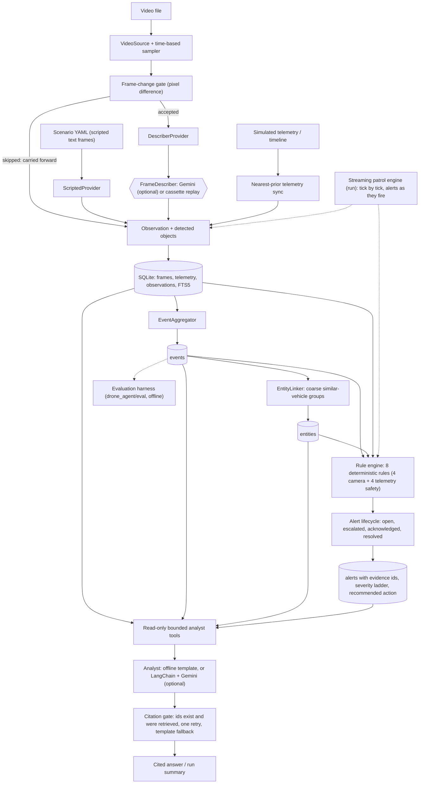

# Architecture

Principle: **FRAME -> OBSERVATION -> EVENT -> MEMORY -> REASONING.** Frames are never judged in isolation.
**Rules decide; the LLM only explains.**

This document is organised by layer. Each layer section keeps its original design rationale and says which
milestone introduced it; the diagram and tables below describe the CURRENT implementation.

## Current architecture


## Stages
| Stage | Responsibility | Milestone |
|---|---|---|
| Scenario / Video | Scripted text-frame scenarios (`ScriptedProvider`), or a real video decoded with OpenCV, sampled every N seconds and gated by a pixel-difference check that skips near-identical frames | M1, M5A |
| VisionProvider / FrameDescriber | `VisionProvider.analyze(frame) -> Observation` is the boundary the pipeline uses; a real model implements the smaller `FrameDescriber.describe(frame) -> ProviderOutput`. Providers: scripted, cassette (record/replay, no key needed) and Gemini (optional, official SDK) | M1, M5A, M5B |
| Telemetry sync | Telemetry samples (timestamp, position, altitude, battery, zone) are joined to each frame by nearest-prior timestamp; the frame inherits its zone and a wall-clock time from the simulated clock. Telemetry older than a threshold is flagged stale (`telemetry_stale`). Telemetry is SIMULATED | M1 |
| Observation | One frame's description plus its detected objects (type, activity, coarse attributes, confidence), with zone, timestamp, frame id, source and telemetry association | M1 |
| SQLite index | `frames`, `telemetry`, `observations`, `detected_objects` (the frame-by-frame index) with an FTS5 keyword index, plus derived `events`, `entities` and `alerts`; SQL filters by time, class and zone | M2-M4 |
| Event Aggregator | Detections with the same object type and zone, compatible stable attributes and a gap within tolerance extend one event (first_seen, last_seen, duration); missed detections are tolerated up to a configured number of frames. Temporal association, not tracking. No LLM | M3 |
| Entity Memory | `EntityLinker` groups separate VEHICLE events whose normalised colour and body type are equal (or that share an explicit plate) into coarse "similar vehicle" entities. People are never linked, and a coarse link never claims physical identity | M3 |
| Rule Engine | Eight deterministic rules with YAML thresholds. Camera rules run over events and entities: loitering (warning at 120 s, the same alert escalates to critical at 300 s at the main gate), after-hours presence, repeat vehicle, restricted-zone entry. Drone-safety rules run over telemetry: low battery, signal loss, altitude anomaly, geofence violation. Alert ids are deterministic and de-duplicated on (rule, subject or episode) | M4, M9b |
| Alerts and lifecycle | Severity, reason, the numbers the rule compared, evidence (event ids, entity id, frame ids, telemetry samples), a severity ladder, a recommended action, and a status history open -> escalated -> acknowledged -> resolved. Only a rule (condition ended) or an operator changes status | M4, M9b |
| Streaming runtime | `run` consumes telemetry and frames one tick at a time (`drone_agent/runtime/`): an adaptive sampler decides whether a frame needs a perception call, the perception agent (timeout, retry, fallback) produces the observation, the context engine updates events and entities, and rules run after every tick, so alerts are persisted and printed the moment they fire. Scripted scenarios only; a real video still goes through ingest-video, build-events and analyze | M10 |
| Analyst Q&A / Summary | Read-only bounded tools over the store, an offline template analyst and an optional LangChain + Gemini tool loop. Answers cite stored ids; a citation gate checks that every id exists and was retrieved, allows one correction retry, then falls back to the template answer. Truncation is stated, never silent. LangChain is confined to `drone_agent/agent/llm.py` | M6, M8a |
| Evaluation harness | Offline, deterministic experiments (gate, compression, flicker, entity memory, rules, citation suite, semantic probe, scale) and their ablation table; no production code depends on it (only the `evaluate` CLI command loads it) | M7 |

## Trust boundary
Rules decide; the LLM explains and answers from tool output only.

## Package layout
```
drone_agent/
  models/ telemetry/ vision/ video/ store/ pipeline/ rules/ agents/ runtime/ agent/ eval/ web/
  __main__.py (CLI)  cli_run.py  scenario.py  simulate.py  ingest.py  clock.py
frontend/  (evaluator dashboard UI)  backend/  (file-by-file guide to the code)
config/events.yaml  config/security_rules.yaml            # event thresholds, rule thresholds
scenarios/ (ten scripted scenarios with ground-truth labels)  tests/  docs/  bench/
output/                                                    # generated databases, cassettes, results (gitignored)
```
Dependency direction: `agent` -> `store`; `rules` -> `models`; `eval` imports the production pipeline, rules and analyst gate but no pipeline, rules, store or analyst code imports `eval`; only the CLI's `evaluate` command loads it (lazily).
The core packages (`video`, `vision`, `pipeline`, `rules`, `store`, `models`, `telemetry`) never import `agent` or `eval`, and only `drone_agent/agent/llm.py`
imports LangChain (`tests/test_scaffold.py` and `tests/test_agent_llm.py` enforce this).

---

# Current state: what M9 to M13 added on top of the layers below

The layer sections that follow keep the design rationale of the milestone that introduced each layer. They
describe the original behaviour of that layer (for example "four rules", "schema version 2", "severity is fixed
per rule"). Where the current code differs, this section is authoritative.

| Topic | Current behaviour | Code |
|---|---|---|
| Rules | Eight families: loitering, after-hours presence, repeat vehicle, restricted-zone entry (camera) and low battery, signal loss, altitude anomaly, geofence violation (telemetry; no camera needed) | `rules/`, `config/security_rules.yaml` |
| Severity | Ladders: one alert rises through severities as the condition worsens (loitering: warning at 120 s, critical at 300 s; battery: 20% then 10%; geofence: high then critical). The alert id never changes | `rules/common.py`, `rules/lifecycle.py` |
| Lifecycle | open -> escalated -> acknowledged -> resolved with a history table; state alerts (loitering, safety) resolve when the condition ends, incident alerts stay open until an operator acts; every alert stores a confidence, a verdict and a recommended action | `rules/lifecycle.py`, `store/derived.py` |
| Zones | Six: main_gate, driveway, parking_area, warehouse, restricted_zone, garage | `models/base.py` |
| Schema | Version 5 (additive migrations): v4 added streaming runs, observation provenance, open events, entity match scores, alert status/history/telemetry evidence, scenarios and agent_runs; v5 added indexes for bounded read paths at 10K+ rows | `store/schema.py` |
| Streaming runtime | `run --scenario NAME` processes one tick at a time; perception tries its providers in order with a timeout per attempt; a frame that every provider fails on is dropped and counted (never invented) and telemetry safety checks carry on | `runtime/`, `agents/` |
| Sampling | Adaptive: a frame is analysed on scene change, zone change, telemetry change, an open event that has not been looked at for 120 s, or after 300 s without a call; otherwise the last observation is carried forward and labelled as carried. For scripted frames the scene signal is a multiset of (class, activity, attributes), so an activity-only change or an extra identical-looking object is a change | `agents/sampling.py`, `runtime/scene.py` |
| Analyst | Thirteen read-only tools (`query_events`, `search_events`, `search_frames`, `get_event`, `get_frame`, `get_alert`, `get_evidence`, `entity_history`, `list_entities`, `list_alerts`, `telemetry_at`, `get_timeline`, `summarize_run`) behind the same citation gate | `agent/tools.py` |
| Scripted versus video | Scripted scenarios run progressively (`run`) or in batch (`ingest`, `build-events`, `analyze`) with the same final result. A real video only has the batch path today: frames are described first, events and alerts are derived afterwards | `runtime/`, `video/ingest.py` |
| Alert resolution | A loitering alert resolves when the event closes because the object was no longer seen in the zone or the camera moved to another zone; a run that simply ends leaves it open. A camera move is treated as a departure, which is a simplification: the last frame of the zone still showed the person | `models/event.py`, `rules/loitering.py` |

---

# Storage and search (M2)

Implemented in `drone_agent/store/` (schema in `schema.py`, API in `store.py`) and `drone_agent/ingest.py`.
Stdlib `sqlite3` only, with explicit parameterized SQL and no ORM.

## Why SQLite
Zero infrastructure (one file, ships with Python), transactional, and it supports both structured
filters (time, zone, object type) and full-text search (FTS5) in the same database, so a single
transaction covers a frame, its objects and its search entry. Persistence is at the application boundary:
rows are converted back into the validated M1 Pydantic models (`Observation`, `Telemetry`, ...).

## Schema (version 1, `PRAGMA user_version`)
| Table | Purpose | Key columns |
|---|---|---|
| `telemetry` | Simulated telemetry samples | `telemetry_id` PK, `timestamp`, `ts_utc` UNIQUE, lat/lon/alt/zone/battery (CHECK ranges) |
| `frames` | Frame-level index | `frame_id` PK, `timestamp`, `ts_utc`, `source`, `zone` |
| `observations` | One per frame | `observation_id` PK, `frame_id` UNIQUE FK, `timestamp`, `ts_utc`, `source`, `zone`, `description`, `telemetry_id` FK NULL, `telemetry_age_seconds`, `telemetry_stale` |
| `detected_objects` | Objects in an observation | `object_pk` PK, `observation_id` FK, `position`, `object_id` NULL, `object_type`, `activity` NULL, `confidence` (CHECK 0..1), `attributes_json` |
| `observations_fts` | FTS5 index | `observation_id` (UNINDEXED), `description`, `objects_text`, `zone` |

Foreign keys are enforced (`PRAGMA foreign_keys = ON`, verified on open). `frames` has no caption column
because the description lives once, on the observation. Events, entities and alerts are not stored yet (M3/M4).
The telemetry age/stale fields are on the observation because they describe *that association*, not the sample.

**Timestamps** are stored twice: `timestamp` is the exact ISO-8601 text including the UTC offset (so the
original timezone round-trips) and `ts_utc` is a fixed-width UTC string used for ordering, range filters and
indexes. Comparing ISO strings that carry different offsets would order them wrongly, so filters only use `ts_utc`.
Range filters (`start`, `end`) are inclusive on both ends.

**Attributes** (`{"color": "blue", "body_type": "pickup"}`) are canonical JSON text (sorted keys, no
whitespace, UTF-8 preserved) in `attributes_json`. Reason: keys are open-ended (whatever a VLM reports),
they are only read back as a whole, and searching them is FTS5's job. An attribute table would need extra
joins for no M2 benefit. They are re-validated by Pydantic when read. Consequence: attribute keys come back
in sorted order, and SQL cannot efficiently filter on an attribute value (SQLite JSON functions could later).

## FTS5 design
One FTS5 row per observation, written in the same transaction as the observation. Searchable text:
the description, an "objects text" (object type, activity and attribute values, e.g. `vehicle parked blue pickup`)
and the zone name. Tokenizer `porter unicode61`: case-insensitive, splits on punctuation
(`main_gate` becomes `main gate`) and stems English words (`walking` matches `walk`).

Search text is not passed to FTS5 as-is. Each word is extracted and double-quoted, and the words are ANDed,
so `blue pickup`, `person main gate` and hostile input such as `'; DROP TABLE x; --` or `NEAR(` are treated as
plain words and cannot inject FTS5 syntax. Results are ranked with BM25; structured filters can be combined with text.

**What FTS5 can do here:** keyword match across description, object attributes and zone; AND semantics; stemming; ranking.

**What it cannot do:** no synonyms or semantics (`truck` does not find an observation that only says `pickup`,
`car` does not find `sedan`), no prefix matching (`pick` does not match `pickup`), no typo tolerance, no phrase or
OR queries through this API, and no understanding of time or negation ("not after midnight" is just words).
Relevance ranking means text results are not chronological. Semantic search and embeddings are postponed by design.
If the SQLite build has no FTS5, opening the database fails with `Fts5UnavailableError`; there is no silent fallback.

## Indexes
| Index | Serves |
|---|---|
| `idx_observations_ts (ts_utc)` | time-range queries |
| `idx_observations_zone_ts (zone, ts_utc)` | zone filter, with or without a time range |
| `idx_objects_type_obs (object_type, observation_id)` | "observations containing object type X" (covering index for the existence probe) |
| implicit: `frames.frame_id`, `observations.observation_id`, `observations.frame_id`, `telemetry.ts_utc`, `detected_objects(observation_id, position)` | primary/unique keys |

`EXPLAIN QUERY PLAN` on the ingested `security_events` database (SQLite 3.45.1):
- zone + time range: `SEARCH o USING INDEX idx_observations_zone_ts (zone=? AND ts_utc>? AND ts_utc<?)`: index used.
- time only: `SEARCH o USING INDEX idx_observations_ts (ts_utc>? AND ts_utc<?)`: index used.
- object type: `SCAN o USING INDEX idx_observations_ts`, then `SEARCH d USING COVERING INDEX idx_objects_type_obs`
  per row. The index makes each probe cheap but the query still visits every observation, so it is linear in observation count.
- text search: `SCAN observations_fts VIRTUAL TABLE INDEX 0:M4`, then a primary-key lookup per matching row.
- Zone and time queries also show `USE TEMP B-TREE ... ORDER BY` because ties are broken by `frame_id`.

`query --explain` prints these plans. No performance or scale claims are made; measurements are M7.

## Ingestion, idempotency and transactions
`scenario -> simulated telemetry -> ScriptedProvider observations -> telemetry sync -> SQLite (+FTS)`.
Ingestion runs in ONE transaction: telemetry first (observations reference it by foreign key), then
frames/observations/objects/FTS rows.

**Idempotency decision: reject duplicates, atomically.** Ids are deterministic (`frame_id`, `obs-<frame_id>`,
telemetry timestamp), so re-ingesting the same scenario violates a PK/UNIQUE key, raises `DuplicateRecordError`,
and rolls everything back; the CLI exits 1 and the database is unchanged. Reason: an upsert could silently
overwrite stored evidence with a changed scenario that reuses the same ids. Trade-off: `frame_id` is a global
key in M2, so one database holds one run; a `run_id` for multi-run databases is a later design decision.

**Transactions:** `Store.transaction()` is a context manager: the outermost use is `BEGIN ... COMMIT/ROLLBACK`,
nested uses are `SAVEPOINT`s, so a failure inside a nested block undoes only that block. `insert_observation`
is atomic on its own (frame + observation + objects + FTS row). Database CHECK constraints are a second line of
defence behind Pydantic validation: a test bypasses validation to inject an out-of-range object and verifies
that nothing (including the FTS row) is left behind.

## Query API and CLI
`Store.query_observations(start, end, zone, object_type, text, limit)` ANDs all given filters and returns
validated `Observation` objects; `get_observation`, `get_observation_by_frame` and `count_*` complete the API.
CLI: `ingest <scenario> --db <path>` and `query --db <path> [--zone] [--object] [--search] [--start] [--end] [--limit] [--explain]`.

---

# Events and entity memory (M3)

Implemented in `drone_agent/pipeline/` (`aggregator.py`, `linker.py`, `normalize.py`, `config.py`, `build.py`),
persisted by `drone_agent/store/derived.py`, thresholds in `config/events.yaml`.
Flow: `stored observations -> EventAggregator -> events -> EntityLinker -> entities -> SQLite`.
No LLM is involved anywhere in this stage, and there are no alerts or rules yet (M4).

```
FRAME OBSERVATIONS                         EVENT                          ENTITY (vehicles only)
23:41 person ─┐
23:42 person  │
23:43 person  │    EVT-P-001  main_gate  23:41 -> 23:49  (8 min)
23:44 person  ├──  evidence: frames 1-4, 6-9              (people are never linked)
23:45 (missed)│    frame 5 = tolerated gap
23:46 person  │
...           │
23:49 person ─┘

blue pickup, parking_area  ── EVT-V-001 ─┐
dark blue pickup, driveway ── EVT-V-002 ─┼── ENT-V-001  "similar blue pickup" (coarse match, 3 appearances)
blue pickup, main_gate     ── EVT-V-003 ─┘
white sedan, parking_area  ── EVT-V-004 ──── ENT-V-002  "similar white sedan" (1 appearance)
```

## This is temporal association, not tracking
The aggregator never looks at pixels and does not estimate motion or identity. It groups *detections* (an
object reported in a frame by a VLM or a script) that agree on object type, zone and coarse stable attributes and
follow each other closely in time. Do not read an event as "we tracked this person"; read it as "detections
that are consistent with one ongoing activity". Likewise the entity memory is not re-identification or face/plate
recognition; it says "a similar vehicle appeared N times".

## What an Event is
`Event` (model in `models/event.py`): `event_id` (`EVT-P-001`, `EVT-V-001`, ... numbered per object type in
first-seen order), `object_type`, `zone`, `first_seen`, `last_seen` (`duration_seconds` = last - first, so a single
sighting has duration 0), `attributes` (most common raw value per key; ties go to the earliest), `activities`
(distinct, in order of appearance), `description` (of the first observation), `observation_ids` and `frame_ids`
(the evidence; `evidence_count` = number of observations), `close_reason` and `entity_id` (vehicles only).
Each detection belongs to exactly one event (tested: evidence rows equal detections). Observations that contain
nothing are not evidence but still count as "missed frames" for events open in their zone.

## Aggregation algorithm (`EventAggregator`, streaming: `process()` per observation, `flush()` at the end)
For each observation in chronological order:
1. **Close** open events that this observation rules out: a different zone is now observed (`zone_change`), or the last
   matching detection is older than `max_gap_seconds` (`gap`).
2. **Match** each detection to an open event with the same object type (and, since step 1, the same zone) whose stable
   attributes are compatible; the most recently seen event wins. Otherwise open a new event.
3. **Count misses:** every open event in this observation's zone that got no detection has missed one frame; more than
   `max_missed_frames` consecutive misses close it (`missed_frames`).
4. Events still open when input ends are closed by `flush()` (`scenario_end`).

**Compatibility:** for each stable attribute (person: `clothing`; vehicle: `color`, `body_type`) present on both the
detection and the event, the *normalised* values must be equal. A key missing on either side is "unknown" and does not
block a match. Normalisation is used for matching only, stored attributes keep the original text:
`dark blue` / `light blue` -> `blue`, `grey` -> `gray`, `pickup truck` -> `pickup`, case/hyphens/spacing ignored.
Colours beyond the configured modifier list (e.g. `navy`) are left alone; nothing is guessed.

**Flicker tolerance** has two knobs (`config/events.yaml`): `max_gap_seconds` (default 180) and `max_missed_frames`
(default 2). In `security_events` frame 5 has no person; the gap is 120 s and 1 missed frame, both within tolerance, so
frames 1-9 stay ONE event with frame 5 shown as "gap tolerated". Both limits are hard: longer gaps split events
(`test_gap_longer_than_max_gap_splits_the_event`, `test_too_many_consecutive_missed_frames_split_the_event`).
Missed frames only count in the event's own zone, because a frame taken elsewhere is not evidence of absence.

**Boundaries.** Events close on gap, missed frames, zone change and end of input. One deliberate deviation from
"close when incompatible attributes appear": an incompatible detection opens a *separate* event but does not close the
existing one. Otherwise two people standing together would keep truncating each other's events. Events crossing
midnight work (timestamps are timezone-aware; tested from 23:59 to 00:01).

## Entity memory (`EntityLinker`, vehicles only)
Separate vehicle events are grouped into an `Entity` (`ENT-V-001`, ...) when ALL hold:
1. the event starts after the entity's latest event ended (overlapping vehicles are different vehicles);
2. explicit plates, if both sides have one, must be shared (conflicting plates never link);
3. equal normalised values for every required attribute (`color`, `body_type`), or a shared explicit plate.
A missing required attribute means unknown and never links, so we never invent evidence. Among candidates the most
recently seen entity wins. Persons and other objects are never linked: person events stay separate on purpose.

**Why coarse and similarity-based.** A VLM reports "blue pickup", not an identity. Two blue pickups look alike, one
vehicle can be described as "dark blue" at night, and the input has no plate evidence. So an entity is labelled
`similar blue pickup` with `match_level = coarse_match`. Only when every linked event carries the same explicit `plate`
attribute is the level `confirmed`. **Why persons are excluded:** clothing is a weak, changeable cue, linking people
across time would be identity recognition with real privacy and error costs, and nothing in the requirements needs it.

**Limitations (possible errors).** False merges: two different blue pickups become one entity; two people with the
same clothing in the same zone and time may share an event. False splits: one person who leaves and returns, or a
drone that leaves a zone and returns within the gap, becomes two events (the zone-change rule is conservative);
a VLM describing the same vehicle as "blue" then "black" produces two entities. Frames and zones come from the drone's
position (M1 assumption), so an event is "seen while the drone was in this zone", not a precise location.
Thresholds are tuned by hand on two scripted scenarios; there is no evaluation on real footage yet.

## Persistence (introduced in schema version 2; the current schema is version 5, see "Current state")
Added tables (`store/schema.py`): `events`, `event_observations` (evidence: event -> observation, chronological
`position`; frames come through the observation), `entities`, `entity_events` (`event_id` UNIQUE: an event belongs to
at most one entity). Foreign keys enforce `entity -> events -> observations -> frames`. Duration and evidence counts
are derived, not stored. Indexes: `idx_events_zone_first (zone, first_seen_utc)` and `idx_events_type_first
(object_type, first_seen_utc)` for zone/type listings over time (used by M4/M6), and `idx_event_obs_observation`
for the reverse lookup "which events used this frame".

**Versioning.** `PRAGMA user_version` is 2. Migrations are ordered and additive (`MIGRATIONS[1]` = M2 schema,
`MIGRATIONS[2]` = M3 tables), so an existing M2 database is upgraded in place without touching its data, the CLI
prints "upgraded database schema from v1", and a database from a newer version is refused
(`test_m2_database_is_upgraded_in_place_without_losing_data`, `test_database_from_a_newer_version_is_refused`).

**Idempotency of `build-events`: replace.** Events and entities are derived data (a pure function of observations +
config), so the command clears them and rewrites everything in ONE transaction. Running it twice gives identical
results and never duplicates evidence; running it with a different config replaces the old events; a failure leaves the
previous derived data intact. This differs on purpose from `ingest`, which rejects duplicates because observations are
source evidence and must never be silently overwritten.

## CLI
`build-events --db DB [--config YAML]`, `events --db DB [--zone] [--object] [--entity] [--evidence EVENT_ID]`,
`entities --db DB [--show ENTITY_ID]`. `--evidence` prints the chain event -> observations -> frames and marks frames
where the detector missed as "gap tolerated". Table cells are printed literally (never parsed as Rich markup).

---

# Deterministic security rules and alerts (M4)

Implemented in `drone_agent/rules/` (`loitering.py`, `after_hours.py`, `repeat_vehicle.py`, `restricted_zone.py`,
`engine.py`, `config.py`, `analyze.py`), persisted by `store/derived.py`, configured in `config/security_rules.yaml`.

```
FRAME -> OBSERVATION -> EVENT -> ENTITY MEMORY -> DETERMINISTIC SECURITY RULES -> ALERT
                                                       ^ config/security_rules.yaml
```

**What this is (and is not).** VLM-derived observations feed deterministic temporal security rules. The rules decide
whether an alert exists; the alert carries the numbers the rule compared and links back to the events and frames
behind it. No LLM is called, and none may create, suppress, escalate or change an alert. The system does not
"detect threats with AI"; it flags patterns (dwell time, time of day, repetition, zone) that a person configured as
worth attention, on top of noisy VLM descriptions. The analyst layer (M6) may only *explain* alerts.

## The four camera rules (defaults from `config/security_rules.yaml`; M9b added four telemetry rules, see "Current state")
| Rule | Fires when | Default configuration | Severity | Alert id |
|---|---|---|---|---|
| `loitering` | an event of a monitored type in a monitored zone has `duration_seconds >= threshold_seconds` | person; `main_gate` 300 s | medium | `ALR-LOITER-<event>` |
| `after_hours_presence` | an event of a monitored type overlaps the daily closed window | person; window `22:00`-`06:00`; all zones; local time of the timestamps | medium | `ALR-AFTERHOURS-<event>` |
| `repeat_vehicle` | a coarse vehicle Entity has `appearance_count >= minimum_appearances` | 3 separate appearances | low | `ALR-REPEAT-<entity>` |
| `restricted_zone_entry` | an event of a monitored type is in a restricted zone | `restricted_zone`; person and vehicle | high | `ALR-RESTRICTED-<event>` |

Each rule is a plain function `evaluate(events[, entities], config) -> list[Alert]`, independent of the others and
tested on its own. There is no rules framework or DSL. `RuleEngine.run()` calls the enabled rules, collapses identical
alert ids and sorts by `(triggered_at, rule order, alert_id)`.

* **Loitering** uses the event's duration, never a frame count or frame id, so the tolerated missed detection in
  `security_events` (frame 5) is irrelevant: M3 already made frames 1-9 one 480 s event. Boundary: a duration exactly
  equal to the threshold fires (`>=`), because the threshold is "the dwell time at which we alert".
* **After hours** compares wall-clock time with the window `[closed_from, closed_until)`: `closed_from` is inside,
  `closed_until` is outside, and if `closed_until <= closed_from` the window crosses midnight. An event fires if any
  part of it overlaps a window (so 21:58-22:03 fires, 21:50-21:55 does not, 05:58-06:03 fires, an event starting at 06:00
  does not). Candidate windows start the evening before the event, so 00:11 is checked against the previous night's
  22:00-06:00 window. **Time zone assumption:** times are property-local wall-clock times. With `utc_offset: null` each
  event's own UTC offset is used (the scenarios are stamped +05:30); a configured `utc_offset` such as `"+05:30"` converts
  every event to that offset first. The computer's clock is never read, so runs are reproducible; only fixed UTC offsets
  are supported (no daylight-saving rules). Times in the YAML must be quoted (`"22:00"`), because YAML reads an unquoted
  `22:00` as the number 1320; the loader rejects that with a clear message.
* **Repeat vehicle** counts *separate events* of one Entity, once, at the configured threshold state: one alert per
  entity, even if it has 5 appearances (`appearance_count` is in the facts and `triggered_at` is the start of the appearance that
  reached the minimum). Wording is deliberately hedged: "A similar blue pickup was observed in 3 separate appearances
  ... This is a coarse attribute match; it does not confirm the same vehicle." A plate-confirmed entity is worded as
  confirmed. The `match_level` (`coarse_match` / `confirmed`) is always in the facts.
* **Restricted zone** works on events, so one continuous stay in `restricted_zone` is one alert, not one per frame.

## Alert model (`models/alert.py`)
`alert_id`, `rule_id`, `severity`, `title` (what), `message` (why, in words), `triggered_at`, `first_seen`/`last_seen`
(evidence span), `zone`, `event_ids`, `entity_id`, `frame_ids`, `facts`. **Facts** are machine-readable and
JSON-serialisable (strings, numbers, booleans, lists of strings), e.g. loitering `{duration_seconds: 480.0,
threshold_seconds: 300.0, zone: main_gate, ...}`, repeat vehicle `{appearance_count: 3, minimum_appearances: 3,
match_level: coarse_match, ...}`, after hours `{event_local_time: 00:11:00, closed_from: 22:00, closed_until: 06:00,
utc_offset: +05:30, ...}`.

**`triggered_at`** is the earliest instant at which the rule's condition held, computed from event timestamps
(loitering: `first_seen + threshold`; after hours: the start of the overlap with the closed window; repeat vehicle: the
start of the appearance that reached the minimum; restricted zone: `first_seen`). This is batch analysis of completed
events: a live variant would fire at the first observation at or after that instant. `first_seen <= triggered_at <= last_seen` is validated.

**Model changes in M4 (please review):** `Severity` changed from `info/warning/critical` to `low/medium/high/critical`
(a fixed vocabulary; INFO and CRITICAL are unused by the default policy), and the M1 placeholder `Alert` was redesigned
(`timestamp` became `triggered_at`; added `title`, `first_seen`, `last_seen`, `zone`, `entity_id`, `facts`). One M1 test changed.

## Overlap and de-duplication policy
1. **Different rules may alert on the same event**, because they describe different risks. A night-time loiterer yields a
   loitering alert *and* an after-hours alert; a person in `restricted_zone` at night yields a restricted-zone alert *and*
   an after-hours alert. No rule suppresses another (this keeps every rule independent and testable); consumers can
   group alerts by `event_ids`. The demo shows it: 6 alerts for 4 distinct situations.
2. **An identical (rule, subject) pair yields exactly one alert.** The id is `ALR-<RULE>-<event or entity id>`, so the same rule
   cannot alert twice on the same event/entity, and the engine collapses duplicates.
3. Rules work on events/entities, not frames, so a long stay is one alert, and one Entity is one repeat-vehicle alert.
4. **Re-running is idempotent** (below).

## Severity policy
Fixed per rule and set in the YAML: restricted-zone entry `high`, loitering `medium`, after-hours presence `medium`,
repeat vehicle `low` (a coarse, similarity-based signal). There is no automatic escalation and no scoring; changing a
severity is a config edit. No LLM is involved.

## Persistence (introduced in schema version 3; the current schema is version 5, see "Current state")
Added tables: `alerts` (id, rule, severity CHECK-constrained to the four levels, title, message, `triggered_at`,
`first_seen`, `last_seen` with UTC keys, zone, `entity_id` FK, `facts_json`) and `alert_events` (alert -> event FK). Only links are
stored: an alert's frames are derived through `alert_events -> event_observations -> observations`, so the chain
`alert -> event/entity -> observation -> frame` is enforced by foreign keys without duplicating evidence. Indexes:
`idx_alerts_triggered (triggered_at_utc)` for chronological listings and `idx_alert_events_event (event_id)` for "which alerts cite this event".
Migration v2 -> v3 is additive; M2 and M3 databases upgrade in place (tested for both).

**Idempotency: replace.** Alerts are a pure function of (events, entities, rules config), so `analyze` rewrites the alerts
table in ONE transaction. Unchanged inputs give identical alerts (deterministic ids), so re-running never duplicates
anything; a changed rules file simply yields the alerts of the new rules. `build-events` deletes alerts (they cite events
that are being replaced and event ids are only stable for one build/config); it reports how many were discarded and the
user re-runs `analyze`.

## CLI
`analyze --db DB [--rules YAML]` prints events/entities analyzed, alerts by rule and severity.
`alerts --db DB [--rule] [--severity] [--zone]` lists alerts; `alerts --db DB --show ALERT_ID` prints the reason, the rule facts,
the triggering events/entity and the evidence frames, ending with a one-line trace
(`ALR-LOITER-EVT-P-001 -> events EVT-P-001 -> frames 1-4,6-9`).

## Analyst layer (M6, `drone_agent/agent/`)
```
stored evidence + deterministic alerts  ->  read-only tools  ->  analyst (LLM or template)  ->  citation gate  ->  answer
```
**Boundary.** The analyst may explain and summarise stored evidence. It cannot create, suppress or re-rate alerts, change event/entity links or add
observations: it has no write path (the tools are read-only methods, there is no SQL tool) and alert severity, events and entities are produced only by the
earlier deterministic stages. **Why LangChain is confined to `agent/llm.py`:** it is only needed to drive a tool-calling chat model; everything else in
`agent/` (tools, citations, session, template analyst, summary) is plain Python, so the deterministic pipeline and the offline analyst run without the
`[agent]` extras (`langchain-core`, `langchain-google-genai`; no LangGraph). Tests enforce that no core package imports LangChain and that only `llm.py` does.

| Module | Role |
|---|---|
| `tools.py` | The ten read-only tools (below). Bounded JSON views; invalid arguments return `{"error": ...}` |
| `evidence.py` | View builders and `ToolLimits`; every view lists the citation refs it contains |
| `citations.py` | Citation parsing and the validator |
| `summary.py` | `run_facts` (structured facts + limitations) and the deterministic `render_summary` |
| `offline.py` | Deterministic template analyst (no key, no network) |
| `session.py` | `AnalystSession`: bounded memory, LLM call, citation gate, one retry, fallback |
| `llm.py` | The only LangChain code: Gemini chat model + a bounded tool-calling loop |
| `prompt.py`, `config.py`, `build.py` | System prompt, analyst model config (`ANALYST_MODEL`), lazy construction |

**Tools** (no arbitrary SQL, no generic execution): `search_observations(query, zone, object_type, start, end, limit)`, `list_events`, `get_event`,
`get_event_evidence`, `list_entities`, `get_entity`, `get_entity_history`, `list_alerts(rule_id, severity, zone, limit)`, `get_alert`, `get_run_summary`.
**Limits** (`ToolLimits`): observations default 8 / max 15; events, alerts, entities 20; evidence observations per event 15; frame ids listed per event or alert 10;
descriptions cut to 200 characters (ending in `...`). Results that were cut carry `total`, `returned` and `truncated`; a tool result over 12,000 characters is refused.
The LLM tool loop is bounded too (6 model rounds, 12 tool calls per answer).

**Citation scheme.** `[frame:10] [obs:obs-10] [event:EVT-V-001] [entity:ENT-V-001] [alert:ALR-REPEAT-ENT-V-001]`: internal references into our own database only.
**Validation** (after every LLM answer): (1) every cited id must exist in the database; (2) it must have been returned by a tool in this conversation (a real but
never-retrieved id is rejected); (3) an answer that states facts must cite something, unless it says "Insufficient evidence"; (4) malformed tokens such as
`[event EVT-1]` and tokens of an UNKNOWN type such as `[evt:EVT-1]` or `[source:x]` are rejected (unknown citation syntax is never ignored; ordinary brackets like `[12:30]` are not affected); (5) identity/intent wording ("the same person", "burglar", "criminal",
"confirmed to be the same vehicle") is rejected unless a negation cue ("not", "no", "cannot", "never", "without", "n't") stands in the same clause within 8 words before it ("It cannot be said that this is the same individual" passes;
"There is no doubt this is the same person" and "not different, this is the same person" do not). Negation is recognised syntactically only; double negatives are not understood.
If validation fails the model gets ONE correction turn naming the problems; if the second answer also fails, the deterministic template answer is returned instead
(mode `fallback`, with the reasons in `notes`). An unavailable model (auth, quota, network) degrades to the same fallback. Only validated or template text is ever shown.

**Template (offline) analyst.** Pattern-matched, not language understanding: alerts (by rule or id), events, entities, zone summaries, blue-pickup style vehicle questions,
after-hours people, objects, run summary and a labelled keyword search; everything else gets "Insufficient evidence" plus the list of supported questions. Output is labelled
"template answer (deterministic, no LLM)". Vehicle wording is always "similar ... coarse attribute match; not confirmed to be the same vehicle". **Truncation is never silent (M8a):** whenever a list is cut (tool caps of 20 events or entities, 3 sampled observations, the 3 vehicle entities that get a full history) the answer says "showing N of M ..., earliest first; K not shown" or "full history for 3 of M ... the other entities are listed briefly"; nothing is added when nothing was cut. A question naming both people and vehicles (without a specific colour or type) is answered with both categories (counts, events by type, entities) instead of vehicles only. The LLM path already receives `total/returned/truncated` from every tool.

**Sessions and follow-ups.** `AnalystSession` keeps the last 6 question/answer pairs in memory (no persistence, no multi-user state) and passes them to the LLM. For the template
analyst a follow-up such as "Where was it seen?" resolves only when the previous answer named exactly ONE entity/alert/event; several candidates leave the pronoun unresolved
(reply: insufficient evidence) rather than guessing. `ask --interactive` or repeated `--follow-up` runs a session from the CLI.

**Summary.** `run_facts` collects structured, bounded facts (counts, time span, zones, object counts, events with their alerts, entities, and data-driven limitations such as
"telemetry is simulated" and "N observations are carried forward"). `summarize` prints the deterministic rendering; with `--provider gemini` the model rewrites those same facts as prose
under the same citation gate. A follow-up ("What objects were observed?") is answered from stored observations/events, never by reprocessing the video.

**Known limitations.** The citation gate proves ids exist and were retrieved, NOT that the sentence around a citation is true: a model can cite a real id for a wrong claim. A live answer used the phrase "vehicle tracking" (the system does coarse attribute grouping, not tracking) and passed the gate; semantic entailment between claims and cited evidence is not verified and is an M7 evaluation target. The
overclaim check is a narrow phrase list, not semantic. The template analyst is brittle outside its patterns. The analyst model can be wrong, slow or rate-limited; the fallback
covers outages, not subtle misstatements. Evidence quality is bounded by the vision model (M5B) and by simulated telemetry.

## Evaluation harness (M7, `drone_agent/eval/`)
An evaluation-only package: it imports the production pipeline, rules and analyst gate but no pipeline, rules, store or analyst code imports it (only the CLI's `evaluate` command loads it, lazily), and it makes no network or API call. `runner.run_all` executes the experiments
(`gate_exp`, `pipeline_exp` for compression/flicker/entity memory, `rules_exp`, `grounding_exp` for the citation suite and the semantic-faithfulness probe, optional `scale`), derives the ablation table from
their results, and writes `results.json`, `results.csv`, `ablation_table.csv` and `summary.md`. `claims.py` is a prototype structured claim-evidence checker that lives ONLY in the evaluation layer. Ablations are done
inside the harness (`entities=[]`, a different `max_missed_frames`, gate threshold 0) so production behaviour is untouched. See docs/evaluation.md for definitions, results and threats to validity.

## Known false positives and false negatives
False positives: a delivery driver waiting at the gate for 5+ minutes is "loitering"; authorised night staff trigger
after-hours alerts (there is no allow-list or schedule); two different vehicles that look alike become one entity and can
trigger a repeat alert; staff with legitimate access to a restricted zone still alert; a VLM misdescribing an object
(a statue as a person) alerts as described; zone comes from the drone's position, not from where the object is.
False negatives: a person who moves between zones, or is missed for longer than the flicker tolerance, becomes several short
events that may each stay below the loitering threshold; a single sighting has duration 0; vehicles at night do not raise
an after-hours alert by default (add `vehicle` to `object_types`, at the cost of noise); a vehicle whose colour the VLM
reports inconsistently splits into two entities and may miss the repeat threshold; nothing is seen while the drone is
elsewhere. Thresholds are hand-set on two scripted scenarios (the 21 labelled synthetic scenarios added in M7 check them, but are also synthetic) and are not validated on real security footage.

---

# Real video ingestion (M5A provider-neutral pipeline + cassette replay; M5B Gemini provider)

Implemented in `drone_agent/video/` (source, sampling, gate, timeline, ingest, synthetic) and `drone_agent/vision/`
(`base.py`, `contract.py`, `cassette.py`, `gemini.py`). M5A built everything around a provider contract; M5B ("Gemini provider" below)
added the Gemini provider as one small, isolated step behind it.

```
video file ─► VideoSource (validated) ─► sampling (every N s) ─► frame-change gate ─► VisionProvider ─► Observation
                                                                        │ skipped                         ▲
                                                                        └─► carry last observation ───────┤
SIMULATED timeline (start time + patrol zones) ─► simulated telemetry ─► nearest-prior sync ─────────────┘
                                                                                                          ▼
                                             the existing SQLite -> events -> entities -> rules -> alerts pipeline
```

## Scripted versus real-video ingestion
| | `ingest <scenario.yaml>` (M1-M4) | `ingest-video <video>` (M5A, M5B) |
|---|---|---|
| Frames | text lines in YAML | frames decoded from a real video file with OpenCV |
| Descriptions | scripted | a provider's output (Gemini, or a cassette replay) |
| Zone / time / telemetry | from the scenario | from a SIMULATED timeline (see below) |
| Output of the front end | `Observation`, `Telemetry` | the same `Observation`, `Telemetry` |
| Everything downstream | identical: `Store`, `build-events`, `analyze` never learn which one produced the data |

## What is real and what is simulated
**Real:** the video file, its decoding, the sampled frames and their pixels, the frame-change gate scores, the frame
identity hashes, and the vision model's descriptions when `--provider gemini` is used. **Simulated:** the drone telemetry (a demo video
carries none), the zone each frame is assigned to, and the wall-clock time of each frame. **Canned:** the demo cassette
generated by `make-demo-video` (never committed) holds descriptions written by that tool, not by a vision model; the
cassette says so in its `provider` field and the CLI prints it.

## Video source (`video/source.py`)
`VideoSource(path)` checks that the file exists and is non-empty, that OpenCV opens it, that FPS is finite and in `(0, 1000]`, that
the container reports frames, and that the FIRST FRAME REALLY DECODES; otherwise `VideoError`. `VideoMetadata`:
file name, `sha256` of the file bytes, `fps`, `frame_count`, `width`, `height`, `duration_seconds = frame_count / fps`
(container frame counts can be inexact; the sampler reports frames it could not reach). A capture is opened per pass in a
context manager, so it is always released.

## Sampling (`video/sampling.py`)
Time-based and deterministic. Sample `k` is at offset `k * every_seconds`; its frame index is `floor(offset * fps + 0.5)`
(round to nearest frame), so the same video and config always give the same indexes, also for non-integer FPS (tested at
12.5 and 29.97 fps). Sampling stops at the end of the video, never repeats a frame for very small intervals, and can be
capped with `max_samples`. The recorded offset of a sample is the decoded frame's own time, `index / fps`. Frames are
read sequentially with `grab()` and only planned frames are `retrieve()`d, which is simple and reliable across codecs
(seeking is a later optimisation). A `SamplingReport` states original frames, duration, samples planned, decoded,
failed to decode, and never reached because the stream ended early.

A `SampledFrame` holds `frame_id` (= `frame_index`, unique within one video and meaningful as evidence), `frame_index`, `offset_seconds`,
`source`, `width`, `height`, `frame_key`, `content_hash` and the pixels. **Pixels are never persisted**: `image` lives only
until `release()` (the pipeline releases each frame right after use), and nothing raw goes into SQLite.

## Frame-change gate (`video/gate.py`)
Purpose: do not send nearly identical sampled frames to a (paid, slow) vision model. Metric: mean absolute difference of
0-255 grey values between small greyscale copies (`resize_width` x `resize_height`, default 64x36) of the current frame and
the LAST ACCEPTED frame. The first frame always passes; a frame is accepted when `score >= threshold` (default 6.0;
`0` accepts everything; `enabled: false` accepts everything). Comparing with the last accepted frame, not the previous
one, means slow drift eventually gets through. Each decision records `(accepted, score, reason)` where reason is
`first`, `changed`, `similar` or `gate_disabled`. **This is not motion detection or object tracking**; it knows nothing
about content, only that pixels changed. The default threshold is an uncalibrated starting point: on the synthetic video,
identical frames score exactly 0.0 and real scene changes score 13-26, so anything between works there; real footage
(sensor noise, compression, lighting) needs calibration; the M7 gate experiment measured misses of small changes at the default threshold (docs/evaluation.md).

**Skipped frames and events (important).** A skipped frame produces no model call. But the event aggregator treats time
without observations as an unobserved gap, so a person standing still in an unchanged scene would be cut into several
events. Policy `carry` (default) therefore records, for each skipped frame, a COPY of the last accepted observation with the
frame's own id and time and `source = "<provider>+carried"`; it costs nothing and keeps a static scene one continuous
activity. Policy `drop` records nothing for skipped frames (see `test_dropping_skipped_frames_shortens_the_person_event`:
the 6 s person event collapses to one frame with duration 0). Carrying asserts "nothing visibly changed, so the same
objects are still there", which is wrong if a small object appears or leaves without changing the small greyscale image
much. The gate is reset whenever the simulated zone changes, so objects are never carried into a new zone.

**A carried observation is temporal propagation, NOT a new inference.** It repeats the description and objects of the last
accepted observation, which the vision model produced for an earlier frame; the model never looked at the carried frame. Its
frame id and timestamp are real (the frame was sampled and judged unchanged by the pixel gate) but its *content* is inherited, and
it is labelled `source = "<provider>+carried"` in the observations table so it can always be told apart from a model answer.
Counts such as "provider calls" and "cassette replays" include only genuine model answers; carried observations are reported
separately ("carried N"). Carry-forward is the default (decided after review); `--skipped drop` is the explicit alternative that
stores no observation for skipped frames.

## VisionProvider boundary (`vision/base.py`, `vision/contract.py`)
`VisionProvider.analyze(FrameInput) -> Observation` is the single boundary and is unchanged for the scripted provider.
`FrameInput` gained optional fields for video (`zone`, `source_name`, `offset_seconds`, `frame_key`, `content_hash`,
`image`); a scripted frame still needs only `frame_id` and `timestamp`.

A real provider implements the smaller `FrameDescriber.describe(frame) -> ProviderOutput`: look at the pixels and report
what is visible. `DescriberProvider` adapts any describer to `VisionProvider` and `observation_from_output` builds the
`Observation`: the pipeline, not the model, assigns `observation_id`, zone, timestamp and source. The provider therefore
never decides where or when something happened, and never decides whether it is dangerous; those belong to the simulated
timeline and the deterministic rules. `PROVIDER_INSTRUCTIONS` (versioned in `contract.py`) tells a model to report only
visible objects and coarse attributes and forbids identity, intent, criminality, unreadable plates and unseen details.

**`ProviderOutput` schema (strict, validated by Pydantic):**
```
{"description": str (1-1000 chars, not blank),
 "objects": [ {"type": "person" | "vehicle" | "other",
               "activity": str | null (1-100 chars),
               "attributes": {lower_snake_case_key: str (1-100 chars)} (max 10),
               "confidence": float 0..1 | null } ]  (max 50 objects)}
```
Unknown keys, wrong types, out-of-range values and blank text are rejected with a `ProviderOutputError` that names the
field. The only normalisation is stripping one surrounding markdown code fence. Nothing else is repaired or filled in.
`confidence` may be null if the provider does not report it; converting such an object to an `Observation` then requires an
explicit `default_confidence` (a placeholder meaning "not reported", not a probability), otherwise it is an error. The rules do
not use confidence today.

## Cassettes (`vision/cassette.py`)
A cassette is a JSON file of recorded, already validated provider responses so that demos and tests need no API key, survive
outages, cost no tokens and are reproducible. Contents ONLY: format/version, a `provider` label (who produced the responses),
the video's file name, sha256, fps, frame count and size, and per frame `key`, `frame_index`, `offset_seconds`, `content_hash`
and `output`. No images, no paths, no secrets, no prompts, and nothing from the confidential assignment.

**Frame identity.** `frame_key = "<video sha256[:16]>:<frame index>"`: stable across machines and OpenCV builds because it
depends on the file bytes, not on decoded pixels; a re-encoded video simply misses. `content_hash` (sha256 of a 32x32
greyscale copy) is an audit value: on replay a difference is counted and shown ("Cassette content mismatches"), not fatal,
because decoders can differ slightly. A cassette recorded for another video is refused up front (`CassetteMismatch`).

**Modes** (`CassetteDescriber`): `replay` answers from the cassette and a missing frame is a clear `CassetteMiss` (the inner
provider is never called); `record` answers from the cassette when it can, otherwise calls the inner describer, stores the
response and `flush()` writes the file deterministically (sorted, stable formatting); `live` always calls the inner describer
and ignores the cassette. The CLI exposes all three (`--cassette-mode replay|record|live`); record and live drive the Gemini describer (M5B, below) and are
unit-tested with a fake client, while replay needs no key and makes no API call.

## Simulated telemetry for video (`video/timeline.py`)
A `VideoTimeline` is a SIMULATED start datetime plus the same patrol configuration as scenarios. `--start` and `--zone` make a
one-zone timeline covering the whole video; `--timeline FILE` gives several zones over time (the same `telemetry:` block as a
scenario). The M1 simulator produces the telemetry and the M1 nearest-prior `TelemetrySynchronizer` attaches it to each
observation, exactly as for scripted data. The timeline must cover the video (else `TimelineError`). The CLI labels the row
"SIMULATED telemetry samples (not from the video)". Frame ids equal source frame indexes, so one database holds one video.

## Synthetic test video (`video/synthetic.py`)
A deterministic 20 s, 10 fps, 320x180 video of four obvious scenes (empty yard, a person static for 8 s, a blue vehicle, empty
yard), written as MJPG `.avi` (each frame is its own JPEG, so identical frames decode identically). It is generated inside the
tests (session fixture) or by `make-demo-video` into the gitignored `output/`; no video is committed. With `--sample-every 2` it
gives 10 samples of which the gate accepts 4 (frames 0, 40, 120, 160) and skips 6.

## CLI
`ingest-video VIDEO --db DB [--provider cassette|gemini] [--cassette FILE] [--cassette-mode replay|record|live] [--model M]
[--sample-every S] [--no-gate] [--gate-threshold T] [--gate-resize WxH] [--skipped carry|drop] [--start ISO --zone Z | --timeline YAML]
[--max-dimension N] [--jpeg-quality Q] [--default-confidence C] [--verbose]`, `describe-frame VIDEO --time S` (one Gemini call, stores nothing) and
`make-demo-video [--out-dir DIR]`. The summary reports video duration, original frames, sample candidates (decoded / failed / beyond
end), gate accepted and skipped, provider calls and cassette replays, observations and objects written, simulated telemetry samples and
stale associations. It does NOT build events or alerts; run `build-events` and `analyze` next. The whole pipeline runs before the
database is opened, so any error (bad video, cassette miss, malformed response, short timeline) leaves no database behind.

## Gemini provider (M5B, `vision/gemini.py`)
Gemini is an OPTIONAL real `FrameDescriber` (official `google-genai` SDK). Nothing else changes: it returns the same validated
`ProviderOutput`, so sampling, the gate, the store, events, entities and rules are untouched.
* **Model:** `--model`, else `GEMINI_MODEL`, else a code default; the selected model is shown in every run summary and is part of the
  provider name (`gemini:<model>`, stored in `Observation.source` and the cassette). A failing model is never replaced by another one.
* **Image preparation:** the OpenCV BGR frame is downscaled only if its longest side exceeds `--max-dimension` (default 1024, aspect ratio kept, never
  upscaled) and JPEG-encoded in memory (`--jpeg-quality`, default 85). No temp files. `cv2.imencode` expects BGR, so there is no manual BGR->RGB step (doing it would
  swap red and blue in the file); a test checks that blue stays blue.
* **Prompt and structured output:** `PROVIDER_INSTRUCTIONS` as the system instruction plus a one-line exception (no confidence). Gemini's native JSON mode receives
  `provider_output_schema()` minus the `confidence` field. The reply text is then validated by our own `parse_provider_output()` (strict Pydantic); there is no regex
  JSON extraction and no repair. The model is never asked about suspicion, intent, identity, "same person/vehicle" or severity.
* **Confidence:** Gemini gives no calibrated probability, so none is requested and the cassette records `null`. Observations get the placeholder
  `0.5` (`--default-confidence` overrides), an UNCALIBRATED constant, not a model probability; nothing downstream uses it for decisions.
* **Failure policy:** missing key or bad settings, auth (401/403, "API key not valid"), model not found (404) and other rejected requests fail immediately, no retry.
  Rate limit (429), timeouts, network errors and 5xx get at most 2 retries (2 s, 5 s). Malformed or empty output gets exactly one retry, then
  `GeminiOutputError`. Error text is scrubbed of the key and the raw SDK exception is not chained. Retries are counted in the run summary.
* **API key:** `GEMINI_API_KEY` from the process environment, or a root `.env` read with python-dotenv (never overriding the real environment). It is never printed
  (only "GEMINI_API_KEY configured: yes"), logged, stored in SQLite or cassettes, or shown in exceptions.
* **Commands:** `describe-frame VIDEO --time S --provider gemini [--model M]` decodes ONE frame, calls Gemini once and prints the validated result; it stores nothing and runs no rules.
  `ingest-video --provider gemini --cassette-mode record --cassette FILE` calls Gemini only for gate-accepted frames, records each validated response, carries forward
  for skipped samples and flushes the cassette even if a later call fails (a re-run resumes and pays only for missing frames; a cassette recorded by another model is rejected).
  `--cassette-mode live` calls Gemini without a cassette. `--provider cassette` replays with ZERO API calls (and applies the same placeholder for Gemini recordings).
* **Real versus simulated:** with Gemini the descriptions of the frames are real model output; the telemetry, zone and wall-clock time are still SIMULATED.

## What a real VLM provider must implement (the contract Gemini follows)
One class implementing `FrameDescriber`: `name: str` and `describe(frame: FrameInput) -> ProviderOutput`.
* **Input:** `frame.image` (BGR uint8 ndarray, typically 320-1920 px wide; downscale and JPEG/PNG-encode it for the API), plus
  `frame.frame_key`, `frame.offset_seconds` for logging. The prompt is `PROVIDER_INSTRUCTIONS`; the JSON Schema is `provider_output_schema()`.
* **Output:** a validated `ProviderOutput`, built with `parse_provider_output(text_or_dict)`. Wrap the network call so that a malformed
  reply gets at most one bounded retry (then raises `ProviderOutputError`), transient errors (timeout, 429, 5xx) get a bounded backoff, and
  authentication errors fail immediately with a clear message. The API key comes only from an environment variable and is never written to
  a cassette, log or database.
* **Wiring:** `DescriberProvider(CassetteDescriber(cassette, CassetteMode.RECORD, inner=MyVlm(), path=...))` records on first use and replays
  afterwards; `ingest-video` exposes `--provider` and `--cassette-mode replay|record|live`. `flush()` must run even if a frame fails
  midway so paid responses are not lost.
* **Not needed:** any change to sampling, the gate, the store, events, entities or rules.
