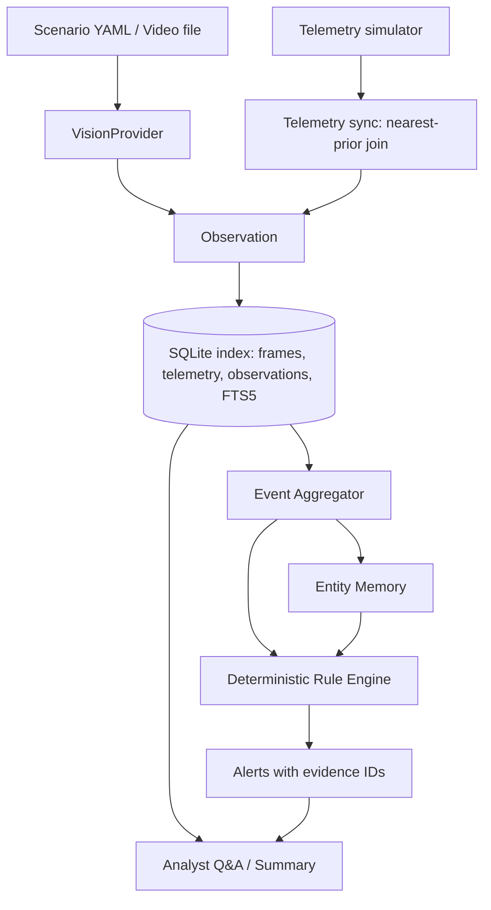

# Architecture (MVP)

Principle: **FRAME -> OBSERVATION -> EVENT -> MEMORY -> REASONING.** Frames are never judged in isolation.



## Stages
| Stage | Responsibility | Milestone |
|---|---|---|
| Scenario / Video | Text-frame scenarios (`ScriptedProvider`) or real video sampled with OpenCV (frame-diff gate skips near-identical frames) | M1, M5 |
| VisionProvider | Interface: frame in, validated observation drafts out. Providers: scripted, mock/cassette (replay cached responses, no key needed), real VLM later | M1, M5 |
| Telemetry sync | Telemetry samples (ts, position, altitude, battery, mode, zone) are joined to each frame by nearest-prior timestamp; the frame inherits `zone` and a wall-clock time from the simulated clock. Frames with no recent telemetry get a `stale_telemetry` flag | M1 |
| Observation | One detected object in one frame: class, attributes (colour, body type, description), zone, ts, frame_id, confidence, derived coarse `signature` | M1 |
| SQLite index | `frames`, `telemetry`, `observations` (the frame-by-frame index), later `events`, `entities`, `alerts`; FTS5 for keyword search; SQL filters by time/class/zone | M2 |
| Event Aggregator | Same class + zone + compatible attributes with a gap within tolerance extends one event (first_seen, last_seen, duration). Tolerance absorbs missed detections. No LLM involved | M3 |
| Entity Memory | At event close, same-signature entity with a sufficient revisit gap increments `visit_count` (e.g. blue pickup at 12:00 and 17:00) | M3 |
| Rule Engine | Deterministic rules with YAML thresholds, evaluated on every event update: loitering, after-hours presence, repeat vehicle, restricted-zone entry. Dedupe key and escalation | M4 |
| Alerts | Severity, message, evidence (event_ids, frame_ids) | M4 |
| Analyst Q&A / Summary | LangChain tool-calling over SQLite. Answers cite IDs; a verifier rejects unknown IDs; template fallback with no LLM. LangChain is confined to `drone_agent/agent` | M6 |

## Trust boundary
Rules decide; the LLM explains and answers from tool output only.

## Package layout
```
drone_agent/
  models/ telemetry/ vision/ store/ pipeline/ rules/ agent/   # agent/ is the only place langchain is imported
scenarios/  tests/  bench/  docs/
```
Dependency direction: `agent` -> `store`; `rules` -> `models`; core packages never import `agent`.
`tests/test_scaffold.py` enforces that the core does not import LangChain.
